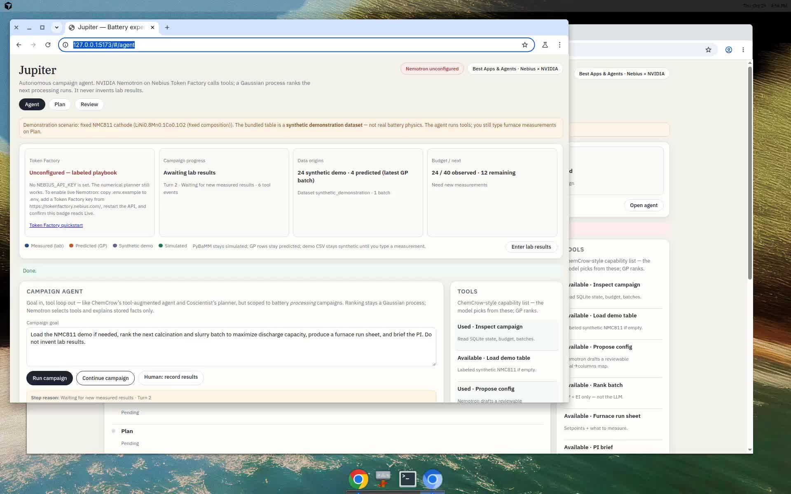

# Jupiter — battery experiment planner

Hackathon MVP for the **Nebius × NVIDIA Global AI Hackathon**, Best Apps and Agents track.

Jupiter is an **autonomous campaign agent** that helps a researcher **improve an existing battery material**. NVIDIA Nemotron on Nebius Token Factory calls tools (inspect, load, generate, run sheet, PI brief). Ranking is still a Gaussian process. Humans still type furnace results. The first version is narrow: a few continuous numeric inputs, one target metric.

This repository ships a **seeded synthetic NMC811 cathode-processing table** so the demo runs without a lab file. That table is an invented response surface. It is **not** real battery physics, and the app does **not** claim to have reduced real lab experiments. The intended benefit is fewer wasted runs once you put real measurements in.

## UI walkthrough

Landing **Agent** workspace → Run campaign (tool transcript, ranked batch, furnace sheet) → inspect **Plan** / **Review**. A campaign status strip on every tab shows Token Factory mode, checkpoint/next action, and measured vs predicted vs synthetic vs simulated origins. About 45 seconds. In this recording Nemotron may be **unconfigured**; the badge says so and the agent uses a labeled playbook of the same tools, not a fake live loop. There is no copilot sidebar; asking is optional under the agent.

[](docs/media/agent-campaign-demo.mp4)

<video src="docs/media/agent-campaign-demo.mp4" poster="docs/media/agent-campaign-demo.jpg" controls muted playsinline width="100%"></video>

Download: [`docs/media/agent-campaign-demo.mp4`](docs/media/agent-campaign-demo.mp4)

## Demo scenario

Fixed composition **LiNi₀.₈Mn₀.₁Co₀.₁O₂**. Tune:

| Input | Unit | Role |
| --- | --- | --- |
| `calcination_temp_C` | °C | Hold temperature |
| `hold_time_h` | h | Isothermal hold |
| `heating_rate_C_min` | °C/min | Ramp |
| `carbon_black_wt_pct` | wt% | Conductive carbon in the slurry |

Target: **maximize** `discharge_capacity_mAh_g` (mAh/g).

## Architecture

```
React (Vite)  ──/api──►  FastAPI
                           ├─ CSV validation
                           ├─ sklearn GaussianProcessRegressor + expected improvement
                           ├─ SQLite (dataset version, config, batches, results)
                           ├─ Nebius Token Factory agent (NVIDIA Nemotron + tools)
                           ├─ campaign playbook when unconfigured (labeled, not live)
                           ├─ optional PyBaMM Chen2020 SPM example
                           └─ optional Materials Project formula lookup
```

Numerical predictions come **only** from the surrogate (or a labeled initial design when *n* is too small). Nemotron never invents μ, σ, EI, mechanisms, citations, or lab results.

## Where NVIDIA and Nebius are used

Server-side Chat Completions against Nebius Token Factory:

- **Base URL:** `https://api.tokenfactory.nebius.com/v1` ([quickstart](https://docs.tokenfactory.nebius.com/quickstart))
- **Default model:** `nvidia/NVIDIA-Nemotron-3-Nano-30B-A3B` ([catalog, 2026-10-27](https://tokenfactory.nebius.com/model-catalog.md))
- **Calls:** goal → config; validation summary; batch explanations; change summary; PI brief; **campaign agent tool loop** ([function calling](https://docs.tokenfactory.nebius.com/ai-models-inference/function-calling)).

Set `NEBIUS_MODEL` to Super or Ultra if you want heavier reasoning (`nvidia/nemotron-3-super-120b-a12b`, `nvidia/Nemotron-3-Ultra-550b-a55b`).

**Offline demo mode** (`NEBIUS_OFFLINE_DEMO=true`) is explicit and labeled. The UI will not treat it as a successful live integration. Missing credentials → badge **unconfigured**; the planner still works.

## Quick start (local)

Needs Python 3.11+ and Node 20+.

```bash
python3 -m venv .venv
source .venv/bin/activate
pip install -r backend/requirements.txt
python scripts/generate_sample_data.py   # already committed; re-run if you change the generator

cd backend
uvicorn app.main:app --reload --port 8000
```

In another terminal:

```bash
cd frontend
npm install
npm run dev
```

Open http://localhost:5173 (`#/agent`). **Plan** (`#/plan`) and **Review** (`#/review`) share the same campaign. Copilot asks grounded questions or links to **Run as agent**. The UI proxies `/api` to port 8000.

### Live Nemotron

```bash
cp .env.example .env
# put your Token Factory key in NEBIUS_API_KEY
# restart uvicorn so pydantic-settings reloads
curl -s http://127.0.0.1:8000/api/inference/status
```

Expect `"mode": "live"`. Then use **Propose config with Nemotron** in the UI and confirm the recommendation panel shows model, latency, and token usage.

Get a key: https://tokenfactory.nebius.com/ (log in, API keys). Hackathon credits: Nebius Builders Program / Devpost promo as listed on the [hackathon site](https://nebiusglobalaihackathon.devpost.com/).

### Tests

```bash
source .venv/bin/activate
cd backend && python -m pytest -q
cd ../frontend && npm test
```

### Docker

```bash
docker compose up --build
# http://localhost:8000
```

Hosted demo: [`docs/deployment.md`](docs/deployment.md), Render blueprint `render.yaml`. Official submit clicks: [`docs/submit-now.md`](docs/submit-now.md).

## Core workflow

1. Load the demo CSV or upload your own.
2. Preview / validation.
3. Select inputs, target, units, maximize or minimize.
4. Bounds, batch size, budget.
5. Generate a ranked batch.
6. Predicted performance, uncertainty (surrogate std), explanation.
7. Export CSV.
8. Type or upload results → generate again.

Limits: ≤6 continuous numeric inputs, one target. Small datasets get a Latin-hypercube **initial design** instead of EI, with an actionable message.

## Optional science extras

Documented in [`docs/scientific-integrations.md`](docs/scientific-integrations.md).

```bash
pip install -r backend/requirements-optional.txt   # PyBaMM
# MATERIALS_PROJECT_API_KEY in .env for DFT property lookup
```

PyBaMM here is a **Chen2020 SPM cell discharge**, not a processing-parameter model. Materials Project returns **computed** crystal properties, not measured capacity.

## Limitations

- Synthetic demo data is for UX and tests only.
- GP quality collapses with tiny, collinear, or badly scaled data — we error or fall back to initial design instead of hiding that.
- Uncertainty is a GP posterior standard deviation, not a lab confidence interval.
- No auth, no multi-user, no robotics, no claim of real-world experiment reduction.

## Repo map

| Path | What |
| --- | --- |
| `backend/app` | API, validator, GP, Token Factory agent |
| `frontend` | Research workspace UI |
| `data/samples` | Seeded demo CSV + metadata |
| `docs/hackathon-submission.md` | Devpost paste |
| `docs/demo-script.md` | ≤3 min video script |
| `docs/submit-now.md` | Nicole’s remaining official clicks |
| `LICENSE` | MIT |

## License

MIT. Copyright (c) 2026 Nicole Hao.
